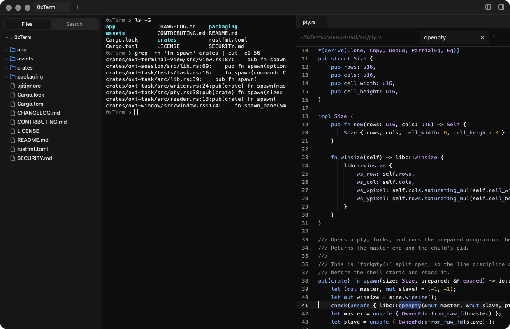
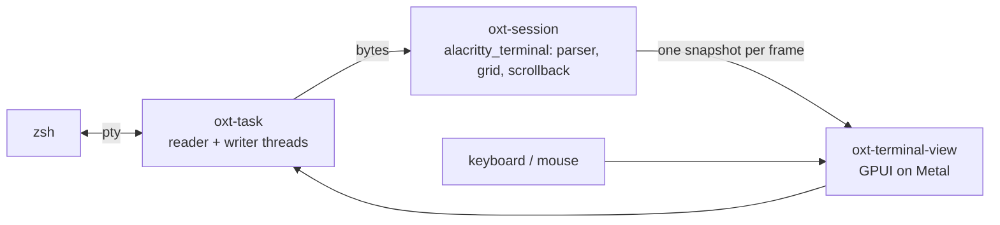

<p align="center">
  
</p>

<h1 align="center">0xTerm</h1>

<p align="center">
  A minimal terminal workspace for macOS, drawn by the GPU.<br>
  <a href="https://0xterm.org">Website</a> ·
  <a href="https://github.com/allocmemory/0xTerm/releases/latest">Download</a> ·
  <a href="#shortcuts">Shortcuts</a> ·
  <a href="#configuration">Config</a> ·
  <a href="CHANGELOG.md">Changelog</a>
</p>

<p align="center">
  
</p>

0xTerm is a terminal for the Mac with file search and a file viewer built in.
It's written from scratch in Rust, and every frame is drawn through Metal.

## Why

I live in the terminal, and I used iTerm2 for years. I wanted something
smaller: a quiet window drawn by the GPU, and a way to find files and read
them without leaving it. cmux, Warp and Wave do that, along with much more
than I need. So I made 0xTerm.

You `cd` somewhere and then open Finder to see what's there. You `grep` and
then copy a path into an editor to read one line. 0xTerm keeps those inside
the window. No account, no AI, no cloud: a shell, the files it's looking at,
and nothing else.

## Features

- **Drawn by the GPU.** The grid is painted through Metal every frame.
  Parsing runs on its own thread, so a flood of output never blocks typing.
- **A real login shell.** Each pane runs your shell on its own pty, with
  `TERM=xterm-256color` and truecolor. Launching from the Dock still gets
  your `PATH`.
- **Tabs and splits.** Split right or down, drag the divider. Inactive panes
  dim. Tabs are named after the running job, like `vim` or `htop`, and fall
  back to the folder name.
- **A file tree that follows your shell.** `cd` and the sidebar moves with
  you. Folders come first, `.gitignore`d files stay out of the way, and the
  tree updates live.
- **Folder search.** Ripgrep-style search of the whole folder, off the main
  thread, grouped by file. Click a hit to open it at that line.
- **A file viewer beside the shell.** Syntax highlighting, line numbers and
  ⌘F find with a match count. It reloads when the file changes on disk.
- **Markdown and Mermaid preview.** Markdown renders as a document, and
  Mermaid diagrams are drawn natively, with no browser in the app.
- **⌘-click a path.** Any `path:line` in the output opens the viewer at that
  line. URLs open in your browser, and OSC 8 hyperlinks work too.
- **Drag a file in.** Drop a file from the tree onto a pane and its quoted
  path is typed at the prompt.
- **One config file** that reloads as you save it, and light and dark themes
  that follow the system.

## Install

Download `0xTerm-<version>.dmg` from the
[latest release](https://github.com/allocmemory/0xTerm/releases/latest), open
it, and drag 0xTerm to Applications.

**Requirements:** a Mac with Apple Silicon, running macOS 13 or later.
0xTerm is built and tested on the current macOS.

**First launch:** releases aren't notarized by Apple yet, so macOS blocks the
first launch. Do one of these:

- Open 0xTerm once and dismiss the warning. Then go to **System Settings →
  Privacy & Security**, scroll down, and click **Open Anyway** next to
  0xTerm.
- Or, in a terminal: `xattr -dr com.apple.quarantine /Applications/0xTerm.app`

After that it opens like any other app.

## Shortcuts

| Keys | Action |
|---|---|
| ⌘T | new tab |
| ⌘N | new window |
| ⌘W / ⇧⌘W | close pane / close tab |
| ⌘D / ⇧⌘D | split right / split down |
| ⌘[ / ⌘] | previous / next pane |
| ⇧⌘[ / ⇧⌘], ⌃⇥ / ⌃⇧⇥ | previous / next tab |
| ⌘B | show or hide the sidebar |
| ⇧⌘B | show or hide the viewer |
| ⇧⌘F | search the folder |
| ⌘F | find in the open file |
| ⌘K | clear the terminal |
| ⌘C / ⌘V / ⌘A | copy / paste / select all |
| ⌘-click | open a `path:line` or a URL |

Right-click a pane to split or close it. Right-click the file tree for
**cd Here**, **New Tab Here**, **Insert Path** and **Copy Path**.

## Configuration

0xTerm reads `~/.config/0xterm/config.toml` (or `$XDG_CONFIG_HOME/0xterm/`).
Every key is optional; anything you leave out keeps the default shown here.
Changes apply to open windows as soon as you save.

```toml
[font]
family = "Menlo"
size = 13.0
line_height = 1.2

[terminal]
shell = ""            # empty means your login shell ($SHELL)
scrollback = 10000
option_as_meta = true # ⌥+key sends ESC+key, for word movement

[theme]
mode = "system"       # or "light" / "dark"

[theme.dark]
background = "#0b0b0b"
foreground = "#e6e6e6"
cursor = "#e6e6e6"
selection = "#264f78"
# ansi = ["#1b1b1b", …16 colors]
```

`[theme.light]` takes the same keys. The full defaults are in
[`crates/oxt-config/src/default.toml`](crates/oxt-config/src/default.toml).

## Build from source

You need:

- Rust (current stable)
- Xcode, not just the Command Line Tools, because GPUI compiles its Metal
  shaders at build time. After installing Xcode, run
  `sudo xcode-select -s /Applications/Xcode.app` and
  `xcodebuild -downloadComponent MetalToolchain`.

```sh
cargo run -p oxterm                 # run a debug build
cargo test --workspace              # run the tests
packaging/bundle.sh                 # build dist/0xTerm.app (release, ad-hoc signed)
packaging/dmg.sh                    # build dist/0xTerm-<version>.dmg
packaging/install.sh                # build and install to /Applications, replacing the old copy
```

`SIGN_ID="Developer ID Application: …" packaging/bundle.sh` signs with the
hardened runtime instead, ready for notarization.

## How it's built

Bytes travel one way from the shell to the screen, and keys travel back:



A window holds tabs, each tab holds a tree of splits, and each split ends in
a pane running a shell. Beside them sits the toolbelt: the file tree, folder
search and the viewer. The toolbelt talks to the panes only through events,
such as "open this file at this line" or "the working folder changed".

| Crate | What it does |
|---|---|
| [`oxt-task`](crates/oxt-task) | pty, child process, reader and writer threads, cwd and foreground job |
| [`oxt-session`](crates/oxt-session) | terminal state; key, paste and mouse encoding; OSC 7 |
| [`oxt-terminal-view`](crates/oxt-terminal-view) | draws the grid; selection, links, input |
| [`oxt-window`](crates/oxt-window) | tabs, splits, panes |
| [`oxt-toolbelt`](crates/oxt-toolbelt) | file tree, folder search, viewer, Markdown and Mermaid |
| [`oxt-config`](crates/oxt-config) | config file and themes |
| [`app`](app) | the `oxterm` binary: menus, windows, config reload |

0xTerm stands on [GPUI](https://www.gpui.rs) and
[gpui-component](https://github.com/longbridge/gpui-component) for the UI,
[alacritty_terminal](https://github.com/alacritty/alacritty) for terminal
emulation, [merman](https://github.com/Latias94/merman) and
[resvg](https://github.com/linebender/resvg) for diagrams, and ripgrep's
`ignore` and `grep` crates for search.

## Not in v0.1

Profiles, a settings window, tmux and SSH integration, triggers, scripting
and auto-update. There are no AI features, and none are planned.

## Contributing

Bug reports and ideas are welcome in
[issues](https://github.com/allocmemory/0xTerm/issues). See
[CONTRIBUTING.md](CONTRIBUTING.md) before opening a pull request, and
[SECURITY.md](SECURITY.md) to report a vulnerability.

## Support

0xTerm is free and built in my own time. If it's useful to you, you can back
it on [Patreon](https://www.patreon.com/c/Allocmemory). Questions:
[allocx@mailbox.org](mailto:allocx@mailbox.org).

## License

Copyright © 2026 allocmemory.

0xTerm is free software under the [GNU General Public License v3.0](LICENSE).
